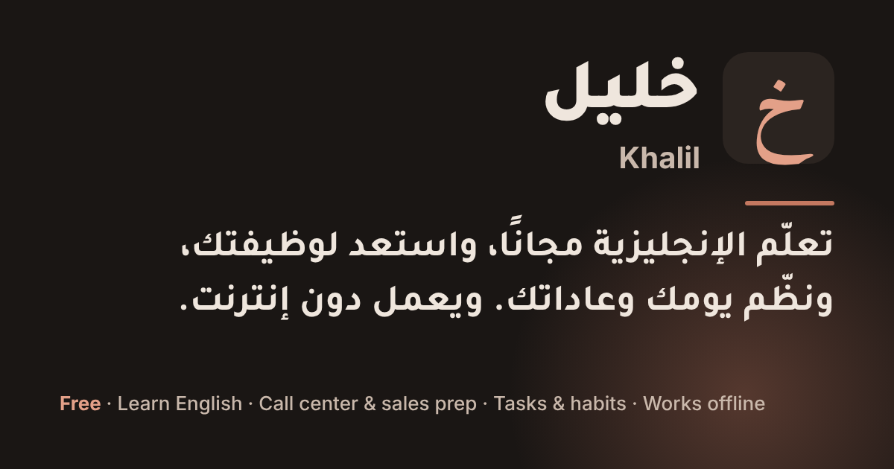

# خطة الظهور في محركات البحث (SEO) لخليل

> كُتبت في 25 أكتوبر 2026. هذا الملف لصاحب خليل أولًا (بلغة بسيطة دون مصطلحات)، ثم لمن يطوّر الكود (القسم الأخير).

## الخلاصة في ثلاثة أسطر

1. **المشكلة:** كان خليل صفحة واحدة خلف تسجيل الدخول، فلم يكن Google يرى فيه إلا شاشة «سجّل الدخول»، ولا شيء يمكن أن يظهر في نتائج البحث.
2. **ما فعلته:** صار لخليل **225 صفحة عامة** يقرؤها أي أحد دون تسجيل، مبنية من الدروس الموجودة في التطبيق نفسه، وكل صفحة مجهّزة لمحركات البحث (العنوان، والوصف، والروابط، والبيانات المنظّمة، والخريطة).
3. **ما عليك أنت:** خطوات قليلة لا يستطيع أحد غيرك فعلها (Search Console، وBing، ونطاق باسم خليل، ونشر الروابط). تجدها في «ما عليك أنت فعله» أدناه، ومجموعها نحو ساعتين.

> لا أحد يستطيع أن يضمن الترتيب الأول في Google. الذي نضمنه أن Google صار يجد محتوى حقيقيًا مفيدًا يفهمه، وأن الصفحات مبنية بالطريقة التي يوصي بها. والنتائج تبدأ عادة بعد أسبوعين إلى ثمانية أسابيع من النشر.

---

## 1. ماذا وجدت قبل البدء؟

| ما فحصته | ما وجدته |
|---|---|
| ما يراه Google في الصفحة الرئيسية | `

` فارغ، ثم شاشة تسجيل الدخول بعد تشغيل JavaScript. |
| عدد الصفحات في خريطة الموقع (sitemap) | صفحة واحدة: `/`. |
| كل عنوان آخر في الموقع (مثل `/abc`) | يفتح التطبيق نفسه برمز 200، فيراه Google صفحات مكررة. |
| وصف الموقع في نتائج البحث | بالإنجليزية فقط، ويذكر «مسارًا من 90 يومًا»، وهذا يخالف قاعدتك أن المسار بلا موعد نهائي. |
| صورة المشاركة (واتساب، وفيسبوك) | أيقونة مربعة صغيرة. |
| المحتوى الموجود داخل التطبيق | كنز: 90 درسًا للمحادثة، و47 سؤالًا للمقابلات بإجابات نموذجية، و384 كلمة لمراكز الاتصال، و29 فصلًا في المبيعات بالعربية. كله مخفي عن Google. |

وبحثتُ في Google عمّا يكتبه الناس، فوجدت أن نتائج عمليات بحث مثل «اسئلة انترفيو كول سنتر» و«كلمات انجليزي للكول سنتر مع المعنى» **ضعيفة**: ملفات PDF منسوخة ومواقع عامة لا تشرح شيئًا. أي أن المحتوى الذي في خليل أفضل مما يجده الناس اليوم، وهذه فرصة حقيقية.

## 2. ما الذي بُني (وهو جاهز الآن)

### الصفحات العامة: 225 صفحة

| القسم | العناوين | العدد | لمن؟ |
|---|---|---|---|
| الصفحة الرئيسية | `/ar` و`/en` | 2 | من يبحث عن تطبيق مجاني لتعلم الإنجليزية وتنظيم اليوم |
| مواضيع المحادثة | `/ar/english-topics` و`/en/english-topics` وصفحة لكل درس | 92 | من يبحث عن «Friendship vocabulary» أو «conversation questions about travel» |
| مراكز الاتصال: الدليل | `/ar/call-center` و`/en/call-center` | 2 | «وظائف كول سنتر انجليزي في مصر»، «مرتبات الكول سنتر» |
| أسئلة المقابلة | صفحة عربية بالأسئلة كلها مترجمة، وصفحة إنجليزية، وصفحة لكل سؤال بإجابته النموذجية | 49 | «اسئلة انترفيو كول سنتر»، «Tell me about yourself call center answer» |
| كلمات مراكز الاتصال | 24 وحدة بالعربية (مع **معنى كل كلمة بالعربية**، وقد كتبتُ معاني الكلمات الـ384 كلها) و24 بالإنجليزية | 50 | «كلمات انجليزي للكول سنتر مع المعنى»، «call center vocabulary» |
| تعلّم المبيعات | `/ar/sales` وصفحة لكل فصل من الفصول الـ29 | 30 | «لماذا يشتري الناس»، «معادلة الثقة في المبيعات»، «تعلم المبيعات من الصفر» |

كل صفحة فيها:

- **عنوان ووصف** مكتوبان لما يكتبه الناس في البحث، ولا يتكرر عنوان في صفحتين.
- **رابط أساسي (canonical)** يخبر Google بالعنوان الصحيح للصفحة.
- **ربط النسختين العربية والإنجليزية (hreflang)** حيث توجد النسختان، فيُظهر Google العربية للعرب والإنجليزية لغيرهم.
- **بيانات منظّمة (Schema)** تشرح لـ Google ما في الصفحة: درس بمستواه (B1 أو B2 أو C1) وكلماته، أو مقال، أو مسار الصفحة (Breadcrumb).
- **روابط داخلية**: كل درس يربط بدروس قريبة منه، وكل وحدة بالتي قبلها والتي بعدها، فيجد Google الصفحات كلها.
- **زر «افتح خليل مجانًا»** في كل صفحة، فيصير الزائر القادم من البحث مستخدمًا.
- **نسخة Markdown** لكل صفحة لنماذج الذكاء الاصطناعي (ChatGPT وClaude وPerplexity)، مع ملف `llms.txt` يدلّها عليها.

والصفحات **سريعة جدًا**: HTML خالص دون JavaScript، ومتوسط حجم الصفحة نحو 17 كيلوبايت (نحو 5 كيلوبايت بعد الضغط)، وتعمل جيدًا على الهاتف (جرّبتها على شاشة بحجم الهاتف وعلى شاشة الحاسوب، في الوضعين الفاتح والداكن).

وهي **تُبنى تلقائيًا من دروس التطبيق** مع كل نشر: إذا أضفت موضوعًا أو سؤالًا أو فصلًا، ظهرت صفحته وحده في الموقع وفي الخريطة، دون أي عمل إضافي.

### إصلاحات في الموقع نفسه

- **خريطة الموقع** (`/sitemap.xml`) فيها الصفحات كلها، و**robots.txt** يدلّ عليها.
- **عنوان أي صفحة غير موجودة** تحت `/ar` أو `/en` يعطي «الصفحة غير موجودة» برمز 404 الصحيح، بدل فتح التطبيق.
- **عنوان الصفحة الرئيسية ووصفها** صارا بالعربية، دون ذكر «90 يومًا».
- **صورة مشاركة** جديدة (1200×630) تظهر حين يرسل أحد رابط خليل في واتساب أو فيسبوك:

  

- **شاشة تسجيل الدخول** صارت فيها جملة تشرح خليل، وروابط إلى الدروس المجانية، فيجد Google الصفحات من الصفحة الرئيسية أيضًا.
- التطبيق **لا يحفظ هذه الصفحات على الجهاز** (فلا يزيد حجمه على المستخدمين)، وما زال يعمل دون إنترنت كما كان (اختبرت ذلك).

## 3. ما عليك أنت فعله (نحو ساعتين، بهذا الترتيب)

### الخطوة 1: انشر التغييرات (5 دقائق)

ادمج الفرع `claude/great-pasteur-xn1x4o` في الفرع الرئيسي، فينشره Vercel تلقائيًا. ثم افتح هذه العناوين وتأكد أنها تعمل:

- `https://khalil-34xv.vercel.app/ar` (الصفحة الرئيسية العربية)
- `https://khalil-34xv.vercel.app/ar/call-center/interview-questions`
- `https://khalil-34xv.vercel.app/en/english-topics/friendship`
- `https://khalil-34xv.vercel.app/en/abc` (يجب أن تظهر «لم نجد هذه الصفحة»)
- `https://khalil-34xv.vercel.app/sitemap.xml` و`/robots.txt` و`/llms.txt`

### الخطوة 2: Google Search Console (20 دقيقة) ← أهم خطوة

في الموقع ملف تحقق من Google (`googleaab5ad69b8d6918e.html`)، فالأغلب أنك أضفت الموقع من قبل.

1. افتح [search.google.com/search-console](https://search.google.com/search-console) واختر موقع خليل (أو أضفه بطريقة «بادئة عنوان URL» ثم «ملف HTML»).
2. من القائمة: **Sitemaps** ← اكتب `sitemap.xml` ← **إرسال**.
3. من **فحص عنوان URL** (أعلى الصفحة) افحص هذه الصفحات واحدة واحدة، واضغط **طلب الفهرسة** لكل منها:
   `/ar`، `/ar/call-center`، `/ar/call-center/interview-questions`، `/ar/call-center/vocabulary`، `/ar/sales`، `/en/english-topics`.
4. ارجع بعد أسبوع: في **الصفحات** سترى كم صفحة فهرسها Google، وفي **الأداء** ما يكتبه الناس قبل أن يصلوا إليك.

### الخطوة 3: Bing Webmaster Tools (10 دقائق)

محرك Bing يغذّي بحث ChatGPT وCopilot وDuckDuckGo. افتح [bing.com/webmasters](https://www.bing.com/webmasters)، واختر **استيراد من Google Search Console**، فينتقل كل شيء بضغطة واحدة.

### الخطوة 4: نطاق باسم خليل (30 دقيقة، ونحو 10 إلى 15 دولارًا في السنة) ← أنصح به بقوة

عنوان مثل `khalil-34xv.vercel.app` يبدو مؤقتًا، فيقلّ من يضغط عليه في نتائج البحث، ويصعب أن يتذكره أحد. اشترِ نطاقًا قصيرًا (مثل `khalil.app` أو `khalilapp.com` إن كان متاحًا) ثم:

1. في Vercel: **Settings ← Domains ← Add**، واجعله النطاق الأساسي (Primary). ثم اطلب مني إضافة تحويل دائم (301) من العنوان القديم إلى الجديد في `vercel.json`، كي تنتقل قيمة العنوان القديم في Google إلى الجديد.
2. أضف النطاق الجديد إلى Supabase: **Authentication ← URL Configuration ← Redirect URLs** (وإلا توقف تسجيل الدخول عليه).
3. أعد النشر مرة واحدة: الصفحات تأخذ عنوانها من Vercel تلقائيًا (`VERCEL_PROJECT_PRODUCTION_URL`). وإن بقي العنوان القديم في الصفحات، فأضف في Vercel ← **Settings ← Environment Variables** المتغير `KHALIL_SITE_URL` بقيمة النطاق الجديد (مثل `https://khalil.app`) وأعد النشر.
4. أضف النطاق الجديد إلى Search Console (نوع «نطاق» بالتحقق من DNS)، وأرسل الخريطة مرة أخرى.

كلما أسرعت في هذه الخطوة كان أفضل: الانتقال إلى نطاق جديد بعد أن يفهرس Google العنوان القديم يمر بفترة اهتزاز قصيرة.

### الخطوة 5: الروابط من خارج الموقع (ساعة في الأسبوع، باستمرار)

يثق Google بالموقع الذي تشير إليه مواقع أخرى. ولا تشترِ روابط أبدًا (يعاقب Google عليها). بدلًا من ذلك:

- حين يسأل أحد في مجموعات فيسبوك أو قنوات تيليجرام لوظائف مراكز الاتصال عن «أسئلة المقابلة» أو «الكلمات»، أجبه وضع رابط **الصفحة المحددة** التي تجيب سؤاله، لا الرئيسية.
- منشور على LinkedIn عن «كيف تستعد لمقابلة مركز اتصال بالإنجليزية» مع رابط الدليل.
- إن كانت لك قناة يوتيوب أو حساب على تيك توك، ضع الروابط في الوصف.
- أرسل صفحة الأسئلة لأصدقاء يعملون في مراكز الاتصال، فهم أكثر من سيشاركها.

## 4. خريطة الكلمات: أي صفحة لأي بحث

لم أستعمل أداة مدفوعة لأحجام البحث (لا وصول لها)، فهذه الخريطة مبنية على فحص نتائج Google في 25 أكتوبر 2026 وعلى ما يكتبه جمهور خليل. وبعد شهر سيعطينا Search Console الأرقام الحقيقية، فنعدّلها.

| ما يكتبه الناس (أمثلة) | الصفحة | لماذا نستطيع المنافسة |
|---|---|---|
| اسئلة انترفيو كول سنتر، اسئلة مقابلة كول سنتر بالانجليزي واجاباتها | `/ar/call-center/interview-questions` | النتائج الحالية ملفات PDF منسوخة؛ صفحتنا عربية ومترجمة ومشروحة |
| tell me about yourself call center answer، why do you want to work in a call center | `/en/call-center/interview-questions/<السؤال>` | صفحة لكل سؤال: ماذا يقيس، وإجابة نموذجية، وأخطاء |
| كلمات انجليزي للكول سنتر مع المعنى، مصطلحات الكول سنتر | `/ar/call-center/vocabulary` ووحداتها | لم نجد في النتائج قائمة بمعانٍ عربية؛ عندنا 384 كلمة بمعانيها |
| وظائف كول سنتر انجليزي في مصر، مرتب الكول سنتر | `/ar/call-center` | مراحل التوظيف، والرواتب التقريبية، والشركات، وأين تقدّم |
| call center vocabulary، call center English words | `/en/call-center/vocabulary` | منافسة أصعب عالميًا؛ هدف طويل الأمد |
| friendship vocabulary، conversation questions about travel | `/en/english-topics/<الموضوع>` | منافسة عالية من مواقع تعليم الإنجليزية؛ نكسب البحث الأطول («B2 friendship vocabulary with examples») |
| مواضيع محادثة انجليزي، تعلم الانجليزية مجانا | `/ar/english-topics` و`/ar` | هدف رئيسي كبير، يحتاج روابط ووقتًا |
| تعلم المبيعات من الصفر، لماذا يشتري الناس، فن التفاوض | `/ar/sales` وفصولها | محتوى عربي أصلي بمصادره؛ النتائج الحالية صفحات بيع كتب |

**هدفان متوازيان:** مكاسب قريبة (أسئلة المقابلة وكلمات مراكز الاتصال بالعربية، حيث النتائج ضعيفة)، وهدف كبير بعيد («تعلم الانجليزية مجانا» و«مواضيع محادثة انجليزي»)، وهذا يحتاج نطاقًا خاصًا وروابط وصبرًا.

## 5. الخطة بعد النشر (90 يومًا)

| الوقت | العمل | من؟ |
|---|---|---|
| الأسبوع 1 | الخطوات 1 إلى 4 أعلاه | أنت |
| الأسبوع 2 | نتأكد في Search Console أن الصفحات تُفهرس، ونصلح أي خطأ يظهر في «الصفحات» | أنا (أرسل لي لقطة شاشة) |
| الأسبوع 3 إلى 6 | **معاني الكلمات بالعربية لمواضيع المحادثة** (نحو 1,150 كلمة)، ثم صفحة عربية لكل موضوع، مثلما فعلنا في كلمات مراكز الاتصال | أنا |
| الأسبوع 3 إلى 6 | ترجمة الإجابات النموذجية والنصائح لأهم 10 أسئلة مقابلة إلى العربية | أنا |
| الأسبوع 4 | زر في كل صفحة درس يفتح الدرس نفسه في خليل مباشرة (بدل الصفحة الرئيسية) | أنا |
| الأسبوع 4 | صفحة «عن خليل وسياسة الخصوصية» (شاشة الدخول تذكر سياسة خصوصية غير موجودة، وGoogle يثق أكثر بالمواقع التي تعرّف بنفسها) | أنت تقرر ما يُكتب، وأنا أكتبها |
| الأسبوع 5 إلى 12 | ساعة أسبوعيًا للروابط (الخطوة 5) | أنت |
| الأسبوع 8 و12 | نقرأ «الأداء» في Search Console: أي صفحات تظهر في المركز 5 إلى 20؟ نحسّن عناوينها ومحتواها أولًا، فهي الأقرب إلى الصفحة الأولى | أنا وأنت |

## 6. كيف تعرف أن الخطة تنجح؟

كل هذا في Google Search Console (ولا شيء منه فوري):

| المقياس | أين تجده | ما نتوقعه |
|---|---|---|
| عدد الصفحات المفهرسة | **الصفحات** | يرتفع من 1 نحو 225 خلال 2 إلى 6 أسابيع |
| مرات الظهور (Impressions) | **الأداء** | أول ما يتحرك: Google يجرّب صفحاتك في النتائج |
| النقرات (Clicks) | **الأداء** | تأتي بعد مرات الظهور |
| متوسط الترتيب | **الأداء** ← الاستعلامات | راقب الأسئلة والكلمات بالعربية أولًا |
| مستخدمون جدد في خليل | لوحة Supabase (Authentication ← Users) | الهدف الحقيقي: زائر من البحث يصير مستخدمًا |

إن لم يتغير عدد الصفحات المفهرسة بعد ثلاثة أسابيع، افتح **الصفحات** في Search Console وأرسل لي سبب الاستبعاد الذي يظهر.

## 7. ما لم أستطع فعله (بصراحة)

- **لم أفتح الموقع المنشور نفسه:** شبكة جلستي لا تصل إلى `vercel.app`. اختبرت كل شيء على نسخة محلية تعمل بقواعد `vercel.json` نفسها (225 صفحة، والخطأ 404، والملفات)، وما زالت الخطوة 1 أعلاه ضرورية بعد النشر.
- **لا أصل إلى Search Console ولا Vercel ولا شراء النطاق:** هذه خطواتك.
- **أحجام البحث تقديرية:** من فحص النتائج، لا من أداة مدفوعة.
- **كلمة «الكول سنتر»:** قاعدة خليل أن نكتب «مراكز الاتصال» بالفصحى، وهكذا كتبتُ في كل مكان. لكن الناس يبحثون بكلمة «الكول سنتر»، فذكرتها بين قوسين في مقدمة الدليل («ويسميها كثيرون «الكول سنتر»») وفي وصف ثلاث صفحات يقرؤه Google (الدليل، والأسئلة، والكلمات). وفي كل موضع آخر «مراكز الاتصال». إن لم تُرد ذلك فأخبرني وأحذفها.

---

## للمطوّرين: كيف يعمل هذا؟

- **`src/seo/`** يبني الصفحات من بيانات التطبيق نفسها: `pages/home.ts` و`pages/topics.ts` و`pages/callCenter.ts` و`pages/sales.ts` تصف كل صفحة (العنوان، والوصف، والكتل)، و`render.ts` يكتبها HTML وMarkdown، و`schema.ts` البيانات المنظّمة، و`site.ts` يجمعها مع `sitemap.xml` و`robots.txt` و`llms.txt` و`sitemap.md` وصفحة 404.
- **`scripts/seoPlugin.ts`** يكتبها في `dist/` بعد البناء، ويضع وصفًا قصيرًا بروابط داخل `#root` في `index.html` للزواحف التي لا تشغّل JavaScript (يُخفى حين يعمل JavaScript)، ويجعل `vite preview` يخدم الصفحات كما يخدمها Vercel.
- **`vercel.json`**: `/ar/...` و`/en/...` تُخدم من `<المسار>/index.html`، والعنوان غير الموجود تحتهما يعطي `404.html`. و`scripts/offlinePlugin.ts` لا يحفظ هذه الملفات في عامل الخدمة (`isSeoFile`).
- **العنوان الأساسي** من `KHALIL_SITE_URL`، وإلا `VERCEL_PROJECT_PRODUCTION_URL`، وإلا `https://khalil-34xv.vercel.app` (`siteOrigin`).
- **صورة المشاركة**: `node scripts/og-image.mjs` يعيد رسم `public/og-image.png`.
- **المعاني العربية**: `src/data/callCenter/vocabAr.ts` (معنى كل كلمة وعنوان كل وحدة) و`src/data/callCenter/interviewAr.ts` (كل سؤال وما يقيسه). كلمة أو سؤال جديد يحتاج سطره هنا، والاختبار يتحقق.
- **لا تغيّر عناوين الصفحات المنشورة:** العنوان مأخوذ من معرّف الدرس (`id`)، ومعرّف السؤال، ومعرّف الفصل، و**عنوان الوحدة** في `vocab.ts`. تغيير أي منها يكسر الرابط القديم في Google.
- **الاختبارات** في `src/seo/site.test.ts`: لكل صفحة عنوان ووصف لا يتكرران، والنسختان مربوطتان في الاتجاهين، ولا رابط داخلي مكسور، والخريطة كاملة، و`vercel.json` يخدم كل صفحة، والبيانات المنظّمة صالحة.
- **صفحة جديدة أو قسم جديد:** صف الصفحة في `src/seo/pages/` (بالكتل الموجودة في `render.ts`)، وأضف عنوانها إلى `ROUTES` في `routes.ts`، وأضفها إلى `buildPages` في `site.ts`. والاختبارات تتحقق من الباقي.
